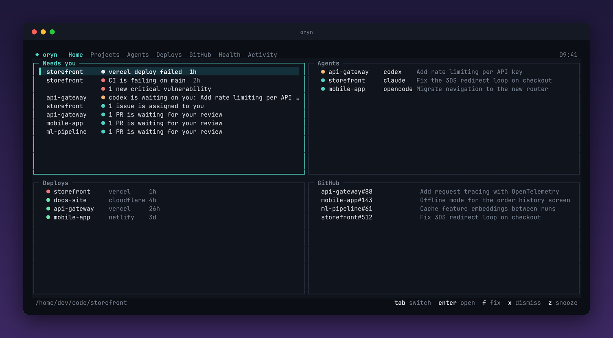
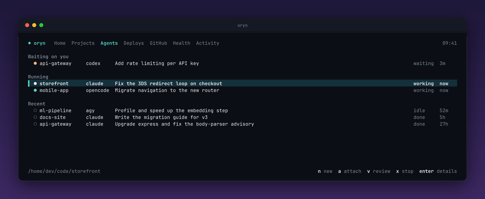
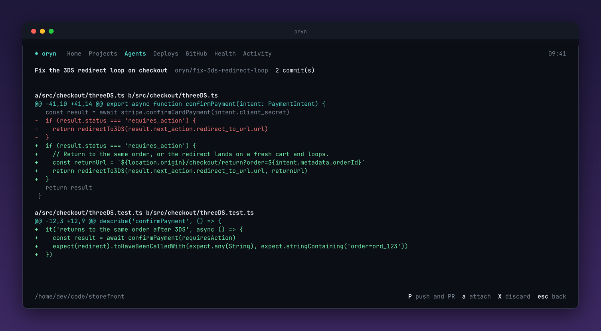
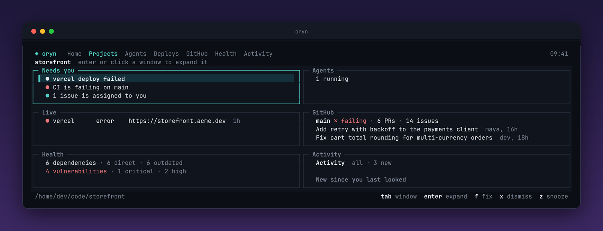
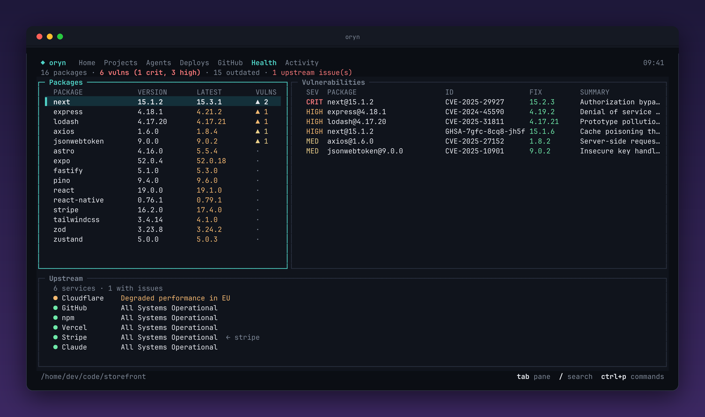

# oryn

**A terminal hub for your projects and the AI agents working on them.**

See what needs you, run agents side by side, ship their work, deploy, and keep
an eye on GitHub, all from one keyboard-driven screen.



Local-first: no account, no server, no telemetry. Your code never leaves your
machine. oryn talks directly to the services you connect, and sends only package
names and versions to public APIs (OSV, npm, PyPI, Go proxy).

> oryn is young and developed on Linux. CI builds it for macOS and Windows, but
> those aren't tested day to day. Bug reports are very welcome.

## A look

| | |
|---|---|
| **Agents.** Every agent in your projects, with the ones waiting on you first. | **Review.** Read what an agent changed, then open a PR or discard it. |
|  |  |
| **A project.** Windows for what needs you, agents, deploys, GitHub, health and activity. | **Health.** Vulnerabilities and outdated packages, out of your way. |
|  |  |

`ctrl+p` opens a command palette for every tab, project and action, and Activity
keeps a timeline of what changed. These screens use made-up projects.

## What it does

- **Needs you:** one ranked list of failed deploys, failing CI, PRs to review and agents waiting on you.
- **Run agents:** start Claude Code, Codex, OpenCode or Antigravity (`agy`) on a task, each in its own git worktree and branch.
- **Ship their work:** review the diff, open a PR or discard it. Hand a failing build to an agent with one key.
- **Give agents context:** `oryn context` and an MCP server tell an agent the stack, commands and state of a project, so it doesn't wander.
- **Deploy:** link, deploy and clean up on Vercel, Netlify and Cloudflare Pages, with live progress.
- **GitHub:** PRs, issues, Actions, commits and releases for every project.
- **Health:** vulnerabilities, outdated packages and upstream status, kept out of your way.
- **Find projects:** list every repo in a folder and pick which to watch.

## Results

Measured on real projects, on one machine. These are small samples, so treat
them as a guide rather than a benchmark.

**Getting an agent up to speed.** Claude Code (Sonnet, headless and read-only)
was asked for a project's commands, CI state, deploys and other agents, in a real
373-file project. Median of 3 runs each:

| | Without oryn | With oryn |
|---|---|---|
| Time | 20s | **6s** |
| Context read | 49,900 tokens | **21,300 tokens** |
| Output written | 1,077 tokens | **359 tokens** |
| Tool calls | 3 | **2** |
| Cost per run | $0.052 | $0.049 |

Answers came about three times faster with under half the context, while cost
barely changed. Without oryn, Claude gave more detail on the CI failure, such as
the failing commit, because it read the runs itself. Expect a smaller share of
savings on long tasks, where orientation is only the start of the work.

**Knowing who else is working.** Asked whether another agent was active in a
repo, Claude without oryn checked the process list and could only say "probably
yes", with the task unknown. With oryn it named the agent and its task in one call.

**A task end to end.** Started from oryn on a throwaway repo with a real bug,
Claude Code found it, fixed it, ran the tests and committed on its own branch in
about a minute, leaving the original checkout untouched. oryn followed it from
waiting to working to idle, and flagged a prompt the agent was stuck on.

**Speed.** With 14 watched projects and 2,800 dependencies:

| | Before caching | Now |
|---|---|---|
| Opening with data on screen | waited for a full refresh | **93ms** |
| Refresh | 12–16s | **about 2s** |

## Install

You need Go (see `go.mod` for the version). Agents also need `tmux`, and opening
PRs needs [`gh`](https://cli.github.com).

```sh
go install github.com/Arnav717/oryn/cmd/oryn@latest
```

Or from a clone, which installs to `~/.local/bin`:

```sh
git clone https://github.com/Arnav717/oryn
cd oryn
make install
```

Tagged releases publish archives for Linux, macOS and Windows with a `SHA256SUMS`
file and GitHub build-provenance attestations:

```sh
sha256sum -c --ignore-missing SHA256SUMS
gh attestation verify oryn_<version>_linux_amd64.tar.gz --repo Arnav717/oryn
```

## Quick start

```sh
oryn
```

1. Press `2`, then `f`, and pick the repos you want to watch.
2. Press `A` to connect Vercel, Netlify or Cloudflare if you deploy there. For GitHub, oryn uses your `gh auth login`.
3. Press `3`, then `n`, to start an agent on a task.
4. Press `ctrl+p` any time to find an action or project.

To give your agents project context:

```sh
claude mcp add oryn -- oryn mcp
codex mcp add oryn -- oryn mcp
```

## Commands

```sh
oryn                           # open the terminal
oryn add [dir]                 # watch a project
oryn rm [dir]                  # stop watching one
oryn ls                        # list watched projects
oryn context [dir]             # what an agent needs to know (--json for machines)
oryn mcp                       # serve that over MCP
oryn claim --as NAME PATH...   # mark files as being worked on
oryn release --as NAME [PATH]  # give them back
oryn scan                      # print a report and exit
oryn deploys                   # show where each project deploys
oryn daemon                    # background refresh and desktop alerts
oryn version
```

## Finding your way around

A tab bar stays on screen everywhere. `1`-`7` switch tabs, `j/k` move, `enter`
opens, `esc` goes back, `r` refreshes, `?` lists every key and `q` quits.
`ctrl+p` opens a command palette with every tab, project and action.

| Key | Tab | Shows |
|---|---|---|
| `1` | Home | Four windows: Needs you, Agents, Deploys, GitHub |
| `2` | Projects | Your watched projects. `enter` opens one, `f` finds repos in a folder, `a` adds, `d` removes |
| `3` | Agents | Agents in your watched projects: waiting on you, running, recent |
| `4` | Deploys | Every deployment on every platform |
| `5` | GitHub | Your inbox: PRs to review and your own PRs |
| `6` | Health | Packages, vulnerabilities and upstream status for all projects |
| `7` | Activity | What's new since you last looked, then earlier events. `f` filters, `e` expands |

**Needs you** ranks failed deploys, failing CI, PRs to review, assigned issues,
agents waiting on you, and critical vulnerabilities that are new since your last
visit. Known vulnerabilities and upstream outages stay on Health.

`x` dismisses an item until it changes, so a new failure under the same heading
still reaches you. `z` snoozes it for a day, and `u` brings back what you set
aside. The list always says how much is hidden.

**A project** opens on six windows: Needs you, Agents, Live, GitHub, Health and
Activity. `tab` moves between them, and `enter` or a click expands one to full
size. `esc` comes back, and `[` `]` jump straight between expanded windows. `p`
deploys, and `f` hands a failure to an agent. On a short terminal you see the
focused window alone.

**The GitHub tab** in a project is read from the folder's git remote, with no
setup. `h/l` moves through Overview, PRs, Issues, Actions, Commits, People,
Releases and Dependabot Alerts, and `enter` opens a row in your browser.

| Key | Where | Action |
|---|---|---|
| `M` | PRs | Merge with your default method for the repo, warning if CI or review isn't clean |
| `a` | PRs | Approve |
| `L` | Actions | Read the end of a run's log, starting from its failed job |
| `R` | Actions | Re-run a run's failed jobs |

Merge, approve and re-run all ask first. They act on the commit you were looking
at, so if a PR moved on after you last refreshed, GitHub refuses.

If a folder's remote isn't the repo you want, map it in the config:

```toml
[repos]
"~/code/app" = "owner/name"
```

## Agents

### Watching them

oryn reads what each tool leaves on your machine and shows the last week's
sessions in your watched projects, most urgent first. `enter` shows a session and
how to get back to it. oryn never writes to those tools' files, and nothing
leaves your machine.

| Tool | Detected states |
|---|---|
| Claude Code | waiting, working, idle, done, failed |
| Antigravity (`agy`) | waiting, working, idle, failed |
| Codex | working, idle |
| OpenCode | working, idle |

For agents oryn started, it also reads the terminal screen, so it sees any tool
stuck on a prompt it recognizes. These are private file formats that can change.
A tool oryn can't read simply doesn't appear.

### Running them

`n` starts an agent: pick a project and tool, describe the task. It gets its own
git worktree and branch (`oryn/<task>`) from your last commit, so agents can't
overwrite each other or your checkout. It runs in tmux, so it keeps going after
you quit oryn.

| Key | Action |
|---|---|
| `a` | Open its live terminal. `ctrl+]` comes back |
| `v` | Review what it changed |
| `P` | Push its branch and open a PR, after asking |
| `x` | Stop it and keep its work |
| `X` | Delete its worktree and local branch, once you type its name |
| `f` | On Home or Overview: start an agent on a failing CI run or deploy |

Good to know:

- Agents keep their normal approval prompts. oryn never turns on skip-permission modes.
- A tool may ask you to trust a new worktree. Press `a` and confirm.
- A worktree separates files, it isn't a sandbox.
- Gitignored files such as `.env` and `node_modules` aren't copied in, and uncommitted changes in your checkout aren't included.
- oryn uses its own private tmux server, so your sessions aren't touched. This doesn't work on native Windows.
- oryn only attaches to or stops agents it started.

## Context for AI agents

Agents waste time exploring. `oryn context` gives one a project's stack, the
commands to run, other scripts, guide files, layout, git state, CI, deploys,
other active agents and claimed files in one call. Inside an oryn worktree it
answers for the project the worktree came from.

`oryn mcp` serves the same over the Model Context Protocol, with the tools
`project_context`, `list_projects`, `list_agents`, `claim_files` and
`release_files`.

Both read local files and oryn's last refresh, so they answer instantly and never
touch the network. Open oryn once, or run `oryn daemon`, to fill in CI and deploy
data. They carry counts, states and names from the project's own committed files,
never PR titles, issues or logs, because outsiders write those. When CI fails on
the default branch, they name the workflow, job and step at that exact commit and
give the `gh` command for the log, so an agent reads it knowingly. Nothing here can deploy, delete, push or start anything,
and claims only touch oryn's own database.

Claims are a signal between cooperating agents, not a lock on the files, and they
last two hours.

## Deploys

oryn works with **Vercel, Netlify and Cloudflare Pages**. It detects them from
`vercel.json`, `.vercel/`, `netlify.toml` and `wrangler.*`, and you can link any
project from its Deploys tab or create a new one for a first deploy.

Connect an account with `A` (oryn verifies a pasted token before saving it), use
`VERCEL_TOKEN`, `NETLIFY_AUTH_TOKEN` or `CLOUDFLARE_API_TOKEN` with
`CLOUDFLARE_ACCOUNT_ID`, or rely on the platform's CLI login.

| Key | Action |
|---|---|
| `p` | Deploy with the platform's CLI, after showing the exact command, with live progress |
| `L` | Read a deployment's build log, following it while it builds. Vercel and Cloudflare only: Netlify's API has no build logs |
| `R` | Put an earlier production deployment back live without rebuilding, after asking |
| `d` | Delete a deployment |
| `X` | Delete the whole project, once you type its name |
| `u` | Unlink the folder in oryn only |

Links are kept in your oryn config, never written into your project. Cloudflare
refuses to delete the live production deployment, so oryn tells you up front.
After a Vercel rollback, new deploys don't go live until you promote one, and oryn
warns you before you confirm. Netlify support and rollback on every platform have
only been tested against a fake server so far.

## Health

| Area | Source |
|---|---|
| Packages | `package-lock.json`, `pnpm-lock.yaml`, `yarn.lock`, `go.mod`, `Cargo.lock`, `uv.lock`, `poetry.lock`, `requirements*.txt` |
| Vulnerabilities | [OSV.dev](https://osv.dev) (GHSA, Go, PyPI, RustSec advisories) |
| Latest versions | npm, PyPI, Go module proxy, crates.io (direct dependencies) |
| Upstream | Statuspage endpoints for your configured services, plus vendors found in your lockfiles. Turn those off with `stack_status = false` |

`tab` switches pane, `enter` opens a package, and `/` searches (`lod`, `chi`).

## Background alerts

`oryn daemon` refreshes on an interval and sends desktop notifications for new
high or critical vulnerabilities, upstream status changes, review requests,
failing CI, and new issues or PRs from other people on your repos. The first run
records a silent baseline, so you aren't flooded. Run it at login with
`contrib/oryn.service`.

## Speed

oryn opens straight away from its last refresh, then updates in the background.
Vulnerability details stay on disk for a week and latest versions for six hours.
The check of your packages against OSV is reused for ten minutes unless a
lockfile changes, so a newly published vulnerability can take that long to show.
If a service is down, oryn keeps showing what it last knew.

## Configuration and data

Config lives at `~/.config/oryn/config.toml`. See
[`config.example.toml`](config.example.toml). Set `github = false` to turn GitHub
off, or `refresh = "10m"` to change the interval.

| Path | Holds |
|---|---|
| `~/.config/oryn/credentials.toml` | Tokens you paste in, readable only by you |
| `~/.local/share/oryn/oryn.db` | Activity history and file claims |
| `~/.local/share/oryn/snapshot.json` | The last refresh, readable only by you |
| `~/.local/share/oryn/cache-*.json` | Cached vulnerability and version lookups |
| `~/.local/share/oryn/agents.json` | Agents oryn started |
| `~/.local/share/oryn/worktrees/` | Their worktrees |

Your GitHub token comes from `gh` or `GH_TOKEN` / `GITHUB_TOKEN`. oryn doesn't
store it, and only sends it to `api.github.com`.

## Roadmap

- AI features: daily brief, explain a failed deploy or CI run, changelog impact
- Promote from oryn, and showing which deployment is live after a rollback
- Later: upgrade desk, custom layouts, custom sources, team sync

## Contributing

Contributions are welcome. [CONTRIBUTING.md](CONTRIBUTING.md) covers setup, how
the code is laid out and the safety rules every change has to keep. Please report
security problems privately, as [SECURITY.md](SECURITY.md) explains.

## License

[MIT](LICENSE)
